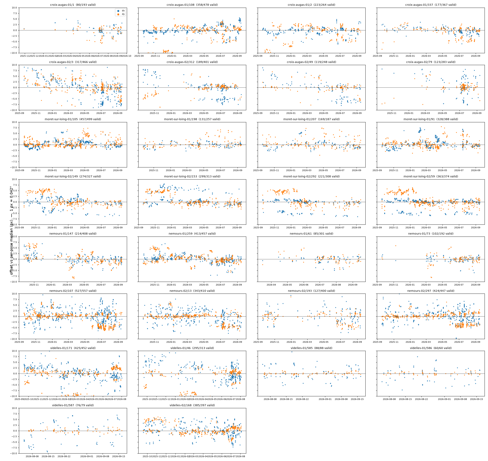

# Camera pose alignment (issue #89)

Does a PTZ camera return to the same framing when it revisits a pose, and if
not, what does the misalignment look like over time?

Builds on Martina Galletti's first study on pyro-sdis `brison-200`
([branch](https://github.com/martinagalletti/vision-rd/tree/issue-89-camera-pose-alignment/experiments/data-quality/camera-pose-alignment)):
translation-only gradient ECC on the terrain area, which she chose over SIFT +
homography. Her method is reused as is, with three additions from the issue
review: estimator calibration, a per-pose median reference, and an analysis of
the rejected registrations.

## Data

SDIS 77 production export, 2025-09-16 → 2026-09-16: 9,914 images (one per
sequence, last frame), 8 cameras, 30 (camera, pose) series (median 327
images per series). Each pose has a reference image (`poses/pose<id>.jpg`).
Horizontal FOV 54.2° over 1280 px → **1 px = 0.042°**.

## Method

- `scripts/measure_offsets.py`: for each image, gradient ECC (translation
  only, rows below 45% of the height) against the pose reference. ECC is
  seeded with phase correlation so that shifts larger than the ECC basin
  (a few px) are still found. The script also records the original
  identity-init result and the offset against the previous image of the same
  pose. `valid` = ECC correlation ≥ 0.5.
- Offsets are reported **relative to the per-pose median position** (`r`),
  not to the reference image, which removes the reference's own bias.
- `scripts/calibrate_estimator.py`: (A) known sub-pixel shifts applied to real
  frames, with a JPEG re-encode; (B) pyro-sdis `brison-200` frames registered
  against the previous frame when they are ≤ 60 s apart.
- `scripts/analyze_offsets.py`: per-pose table, plots, metrics.

## Results

### The estimator is not the limiting factor

| Calibration | Result |
| --- | ---: |
| Synthetic shifts 0–5.3 px: max median bias | 0.02 px |
| Synthetic RMSE | 0.014 px |
| Neighbour pairs ≤ 60 s (brison-200): median | 0.18 px |
| Neighbour pairs: p95 | 7.7 px ⚠ |

There is no integer locking. The real-world median noise floor is about
0.2 px, so brison-200's 0.52 px median is roughly 3× the floor and within
its p75 (0.95 px): brison barely moves. The neighbour p95 is high because of
**backlit scenes with moving clouds near the skyline**: ECC locks onto the
clouds and still reports cc > 0.8. The cc ≥ 0.5 gate does not filter this
failure mode.

### SDIS 77 PTZ cameras do move, an order of magnitude more than brison

| Offset vs per-pose median (valid only) | px | deg |
| --- | ---: | ---: |
| Median | 2.6 | 0.11 |
| p95 | 10.9 | 0.46 |
| p99 | 42 | 1.8 |
| > 5 px | 25% of images | |
| > 15 px | 3.7% of images | |

Validity is 75% (Martina had 53% on brison). Consecutive visits of the same
pose differ by a median 0.85 px (p95 7.1 px).



### Three behaviours, not a slow drift

1. **Vertical offset states, mostly shared by all poses of a camera.** Weekly
   median dy per pose shows two different patterns:
   - *One clean step*: moret-sur-loing-02 sits at +4.5 px on all 4 poses from
     late Sep to late Dec 2025, then at 0 from early Jan 2026. This fits a
     preset recalibration.
   - *Week-to-week toggling between two tilt positions*, on all poses at
     once: nemours-02 alternates between 0 and −4.5 px from late May to Sep
     2026, and videlles-01 between 0 and −10 px from Jan to Apr 2026. A
     recalibration would not flip back and forth every week. The pattern looks
     more like tilt homing that does not always land in the same place (e.g.
     after a reboot).
   - croix-augas-01 goes −10 → 0 → −9 → 0 between Sep 2025 and Jan 2026, but
     only on poses 2 and 108, while pose 337 stays at 0.

   Matching these against recalibration and reboot dates would tell the
   causes apart.
2. **Recurring bimodal pan stops at about ±5–6 px (0.25°).** On
   moret-sur-loing-02/292 and /59 a subset of patrols lands about 5.5 px off
   in x, all year long. This looks like motor backlash or step quantisation.
   It matches the issue's "one patrol out of N stops off" hypothesis.
3. **Rare large tilt misses of 20–45 px (1–2°)**, in 2–4% of images, on 24
   of the 30 poses. Checked visually: the skyline really is higher in the
   frame (e.g. croix-augas-02/3 on 2026-04-14: dy −29 px).

No continuous drift is visible on any series.

### Pose references are themselves off

The median offset of each pose's reference image relative to that pose's
typical position is 2.3 px, and up to 6.7 px (croix-augas-02/3). An
occlusion mask drawn on the reference therefore starts 0.1–0.3° off before
any patrol error is added. Using the per-pose median removes this bias.

### Rejections

- Night data barely exists in this export: 0.9% of images are IR, because
  detections happen in daytime. Only 8% of those IR frames register.
  **Whether cameras drift more at night cannot be answered from detection
  sequences.** It needs patrol frames sampled around the clock.
- Magnitude vs correlation: the median offset rises only slightly below the
  gate (2.3–2.9 px valid vs 3.0 px in cc 0.4–0.5), so the valid subset is not
  strongly biased low. The > 15 px rate climbs at cc < 0.3 (25%), but most of
  those are failed registrations.
- Phase-correlation seeding changes 159 valid results by > 1 px and raises
  validity from 73.0% to 74.6% compared with identity init.

### Metadata note

`camera_azimuth − pose_azimuth` jumps by up to 5.7° on one date per pose
(Aug 2026), and no matching image shift appears. This is a recalibration of
the azimuth metadata, not camera motion.

## Implications

- **Geolocation:** p95 0.46°, p99 1.8°. Small compared with the azimuth error
  budget most of the time, but the 1–2° tilt misses and the camera-level
  tilt states (up to 10 px) are not negligible.
- **Occlusion masks:** registering every frame to the per-pose median
  (≈ 4 min of CPU for a year of images) and shifting the mask by (dx, dy)
  would absorb all three behaviours. Do not trust registrations on backlit
  frames with cloud-heavy skylines.

## Limitations / next

- One frame per sequence, detection-biased (daytime, smoke present). The
  terrain crop can include smoke.
- Fixed 45% crop: on these cameras the skyline sits at 25–40% of the height,
  so the most stable structure is excluded. Including it with a sky mask
  would help vertical precision and backlit cases.
- Event attribution (reboot, maintenance, wind) needs camera logs.

## Reproduce

```bash
make install
ln -s /path/to/sdis77-export data/01_raw   # sequences.csv, poses/, YYYY-MM-DD/
uv run python scripts/measure_offsets.py --data-dir data/01_raw \
    --output data/07_model_output/offsets_crop045.csv
uv run python scripts/calibrate_estimator.py --data-dir data/01_raw \
    --output-dir data/07_model_output
uv run python scripts/analyze_offsets.py \
    --offsets data/07_model_output/offsets_crop045.csv \
    --calib-dir data/07_model_output --output-dir data/08_reporting
```
