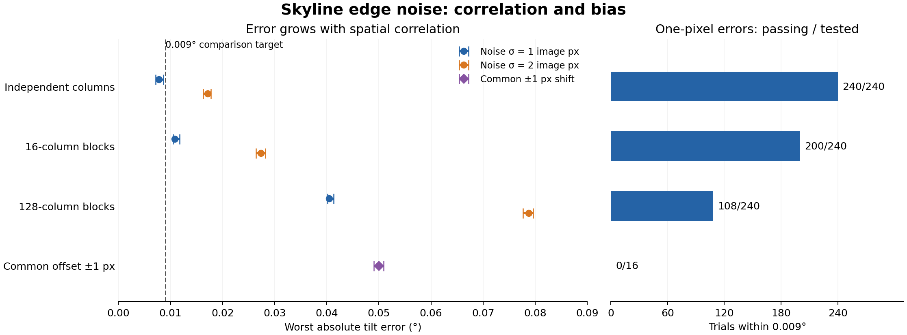

# Do skyline errors average out? — #163

**Question:** how does correlation between skyline-edge errors affect tilt?

## Setup

| Variable | Values |
|---|---|
| Skyline / camera | Flat or ridged; 1280×720; known 60° FOV, 2° tilt |
| Orientation | Roll 0° / 1°; fixed azimuth or joint search ±2° |
| Noise | Gaussian σ = 1 / 2 image px, rounded to rows |
| Correlation | Independent columns; shared across 16 / 128 columns |
| Controls / repeats | Clean edge, common shift ±1 px; 30 paired seeds; 1,464 trials |

Analytic skylines replace terrain sampling; the calibration fitter is unchanged
and samples at most 384 columns. Noise means vary between images.

## Results



Ranges span eight profile/roll/fit settings; each noise setting has 30 seeds.
Counts describe synthetic cases, not field success rates.

| One-pixel noise | Tilt spread (°) | Within 0.009° |
|---|---:|---:|
| Independent columns | 0.00304–0.00318 | 240/240 |
| 16-column blocks | 0.00567–0.00572 | 200/240 |
| 128-column blocks | 0.01472–0.01571 | 108/240 |

**Finding:** 128-column correlation increases tilt spread about **5×**.
A common one-pixel shift produces **0.04998°** of tilt bias relative to
the clean fit. The entire 0.009° plains budget allows only **0.18 px of
shared bias**. All fits passed the gates, including those over budget.

## Next experiment

For the manual skylines in [#163](https://github.com/pyronear/vision-rd/issues/163),
measure signed bias and residual correlation length; compare refinements by
their resulting tilt error before choosing a larger model.

**Scope:** synthetic skylines, known optics and shared renderer/fitter geometry.
Real mask errors and field accuracy remain unmeasured; [#161](skyline-floor.md)
covers the separate DSM-based experiment.

## Run

```bash
uv sync --frozen --python 3.11
uv run python edge_noise.py --params edge_noise.yaml
uv run --script plot_edge_noise.py
```

[Config](edge_noise.yaml) · [Data](edge-noise.csv) · [Source hashes](edge-noise-provenance.json)
